# Co-folding at Scale: Benchmark, Fine-Tune and Serve on Ray

Co-folding models predict how a drug candidate binds to its protein target, using only the protein
sequence and the molecule's chemical structure [[4]](#ref-4). Published accuracy numbers usually come from curated
benchmarks that look like the models' training data. Real drug discovery is harder: a single binding
pocket, hundreds of related compounds, and new chemistry that the model has never seen.

This repository tests co-folding models in that setting, fine-tunes a general model on 1 target's fragment
structures, and runs the full workflow on Ray.

- **Data:** 3 antiviral drug discovery campaigns with 2,147 experimentally solved protein-ligand
  structures [[1]](#ref-1), [[12]](#ref-12).
- **Models:** Boltz-2 [[2]](#ref-2), OpenFold3 [[3]](#ref-3) with the OpenBind-0 weights [[1]](#ref-1), the general OpenFold3
  145k checkpoint, and OpenFold3 fine-tuned on EV-A71 2A fragments (the OpenBind release and our own Ray Train runs).
- **Workflow on Ray:** distributed inference, pose scoring, fine-tuning, hyperparameter search and a live
  prediction service [[13]](#ref-13).

The repository accompanies a hands-on workshop at the AI Drug Discovery & Development Summit 2026, in 3
notebooks: `01_ray_and_offline_inference.ipynb`, `02_train_and_tune.ipynb` and `03_serve.ipynb`. Each one
stands alone, so you can start at any of the 3. It can also be run as a standalone benchmark.

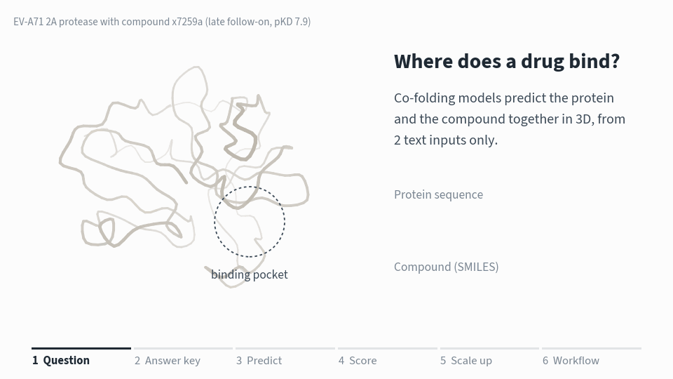

<sub>Experimental structures and model outputs for EV-A71 2A compound x7259a.</sub>

| Target | Source | Binding events | Compounds | With measured affinity |
|---|---|---|---|---|
| EV-A71 2A protease | OpenBind release [[1]](#ref-1) | 925 | 699 | 601 (pKD) |
| SARS-CoV-2 main protease (Mpro) | ASAP Discovery and COVID Moonshot [[12]](#ref-12), via Fragalysis | 628 | 308 | 164 (pIC50) |
| MERS-CoV main protease (Mpro) | ASAP Discovery, via Fragalysis | 594 | 285 | 142 (pIC50) |

## Contents

- [Key findings](#key-findings)
- [Background](#background)
- [Study design](#study-design)
- [Results](#results)
- [Interactive viewer and live prediction](#interactive-viewer-and-live-prediction)
- [System design on Ray](#system-design-on-ray)
- [Repository layout](#repository-layout)
- [Getting started](#getting-started)
- [Runbook](#runbook)
- [Configuration reference](#configuration-reference)
- [Troubleshooting](#troubleshooting)
- [Data sources and licenses](#data-sources-and-licenses)
- [References](#references)

---

## Key findings

- **Accuracy depends on the target.** On late follow-on compounds, Boltz-2 reaches 92% on SARS-CoV-2 Mpro and 1%
  on EV-A71 2A; the general OpenFold3 145k model reaches 88% and 24%.
- **OpenBind-0 is an in-distribution reference, not a generalization test.** It reaches 91% on EV-A71 2A late
  follow-ons, but it comes from the consortium that produced these structures, and its training cutoff is later
  than almost all of them. On EV-A71 2A fragments it reaches 28%.
- **Fine-tuning on fragment structures closes much of the gap.** Starting from 145k and training only on the
  66 fragment-screen structures, accuracy on held-out late follow-ons rises from 23.9% to 44.8% in 2.4 hours
  on 8 L4 GPUs. The OpenBind team's released checkpoint, from the same starting weights, reaches 78.1%.
- **Fine-tuned models are specialists.** The released fine-tune drops to 57% on SARS-CoV-2 late follow-ons.
- **More inference compute helps little.** Searching Boltz-2 inference settings with Ray Tune raised its EV-A71 2A
  accuracy from 0% to 13.5%, at about 6 times the GPU cost.
- **Affinity ranking is uneven.** Boltz-2's predicted affinity correlates with measured values at Spearman
  ρ = 0.41 to 0.86, depending on the target.

All numbers are measured in this pipeline, with 1 predicted pose per compound. The OpenBind paper reports
different values for the same models (for example 145k at 12% on all EV-A71 2A follow-ons, where we measure 36%),
because it selects the top-ranked of 25 poses and uses a different MSA and alignment. Compare numbers within
1 source only.

---

## Background

### Binding pockets, poses and affinity

- **Binding pocket.** A protein folds into a 3D shape with pockets on its surface. In an enzyme, one of
  them is the active site. The EV-A71 2A protease cuts the viral polyprotein into working parts, so a
  molecule that blocks its active site stops the virus from assembling.
- **Pose.** The position and orientation of a molecule inside the pocket.
- **Affinity.** How tightly the molecule is held. Pose and affinity are measured separately, and a model
  can predict one correctly and the other incorrectly.
- **Crystal structures as ground truth.** X-ray crystallography shows the position of every atom in a
  protein-ligand complex. It is slow and expensive, so 925 public binding events on a single target is
  an unusually rich benchmark.

### Co-folding prediction

A co-folding model receives only the protein sequence and the ligand's SMILES (Simplified Molecular
Input Line Entry System) string, a line of text that encodes the molecule's atoms and bonds [[5]](#ref-5). It
predicts the protein structure and the ligand pose together [[4]](#ref-4), so the pocket can change shape to fit the ligand. This
matters for EV-A71 2A: a loop next to the active site is closed in the empty protein and opens when a
ligand binds. Docking into a fixed protein structure fails in exactly this case.

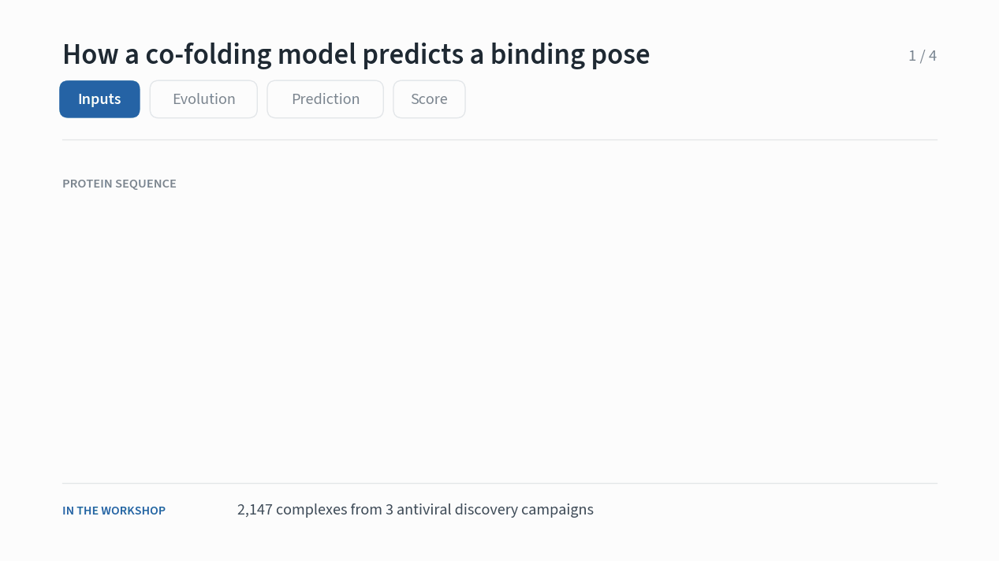

The models also use a **multiple sequence alignment (MSA)**, a set of related protein sequences from
other species. Residues that change together during evolution are usually in contact in 3D, and this
signal drives much of the folding accuracy. Every complex of a target shares the same protein, so the
pipeline computes 1 MSA per target in advance [[8]](#ref-8).

### Pose evaluation

1. Superpose the predicted protein on the crystal protein.
2. Measure the average distance between matching ligand atoms. This is the **ligand RMSD**.
3. Count the pose as correct if the RMSD is below **2 Å**, about the length of a chemical bond [[9]](#ref-9).

Above 2 Å, the ligand is usually in the pocket but turned the wrong way. Any design idea based on such
a pose is unreliable.

### Structure of a discovery campaign

- **Fragment screen.** Thousands of small molecules (about 15 heavy atoms) are soaked into protein
  crystals. Most do not bind. The few that do bind weakly, but they show which parts of the pocket accept
  chemistry.
- **Follow-on design.** Medicinal chemists grow the best fragments into larger, more potent compounds
  over several design cycles.

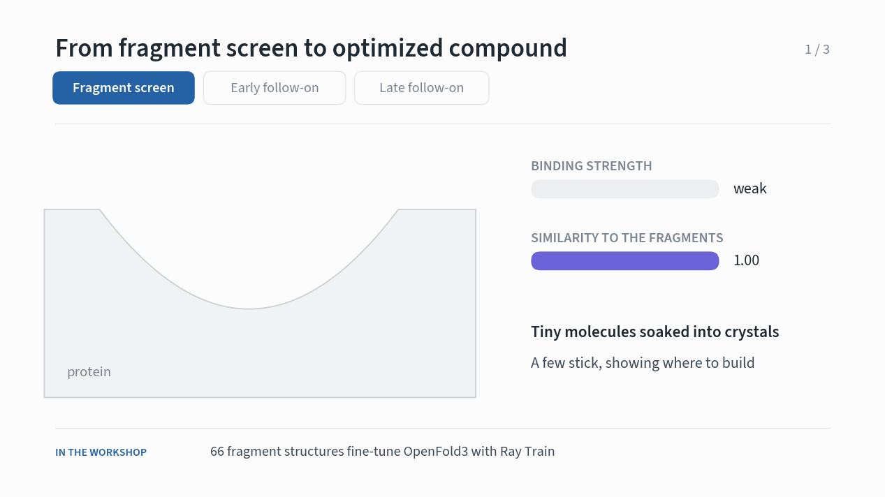

### Generalization to new targets and chemistry

- Co-folding models are trained on the Protein Data Bank [[6]](#ref-6), which covers some protein families well
  and others poorly.
- A model can do well on benchmarks that resemble its training data and poorly on a new target [[7]](#ref-7).
- The OpenBind complexes have a median similarity of about 40 to public structures released before 2021.
  Published co-folding success rates are 80 to 90% above a similarity of 80, and 10 to 40% below 50 [[1]](#ref-1), [[7]](#ref-7).
- Splitting results by campaign stage tests the same question from the chemistry side: follow-on
  compounds move further from anything the model has seen.

### Affinity prediction

Pose is a geometry problem. Affinity is a free energy, which also depends on entropy, water displaced
from the pocket and protein flexibility. The OpenBind study [[1]](#ref-1) reports a striking negative result: a
baseline that uses only molecular weight ranked compounds better than every structure-based method.
Larger molecules tend to bind more tightly, and a model that learns only this trend has learned nothing
about the pocket.

### Target-specific fine-tuning

Fragment-screen structures show a model what the target pocket looks like with a ligand bound, and which
chemistry it accepts. This knowledge carries over to follow-on compounds, which share the pocket even
when their chemistry is new. Every campaign produces fragment structures early, so this is the result
most relevant to a discovery team.

---

## Study design

### Models

| Key | Model | Notes |
|---|---|---|
| `boltz2` | Boltz-2 [[2]](#ref-2) | Predicts pose and binding affinity |
| `openbind0` | OpenFold3 [[3]](#ref-3) with the OpenBind-0 weights [[1]](#ref-1) | General-purpose co-folding model |
| `of3p2` | OpenFold3 145k (`of3-p2-145k.pt`), a general model that predates the OpenBind data | Starting point of both fine-tunes; runs in OpenFold3 0.4.3 |
| `of3ft` | OpenFold3 145k fine-tuned on the EV-A71 2A fragment screen by the OpenBind team [[1]](#ref-1) | Released checkpoint, trained on EV-A71 2A fragments only |
| `of3ray` | OpenFold3 fine-tuned in this repository with Ray Train | Weights from `finetune_ray_train.py`; pass `--of3ray-legacy` for runs started from 145k |

### Campaign stages

Each binding event belongs to the fragment screen or to the early or late follow-on phase. For EV-A71
2A, follow-ons are split at the median crystal ID, which follows the order of the campaign.

| Stage | SARS-CoV-2 Mpro | MERS-CoV Mpro |
|---|---|---|
| Fragment | COVID Moonshot XChem fragment screen [[12]](#ref-12), up to 16 heavy atoms | None |
| Early follow-on | ASAP compounds in the Polaris training set | Same |
| Late follow-on | ASAP compounds in the Polaris test set, made later | Same |

- Compounds without potency data are staged by crystal order.
- Binding events more than 8 Å from the catalytic cysteine are left out of the curated benchmark.

### Metrics

| Term | Meaning |
|---|---|
| Ligand RMSD | Distance between predicted and crystal ligand atoms after superposing the protein on its Cα atoms |
| Success rate | Share of binding events with ligand RMSD below 2 Å |
| Published | The OpenBind authors' value for the same method on the same complexes [[1]](#ref-1) |
| Similarity | Highest Morgan-fingerprint similarity [[10]](#ref-10) to any fragment-screen ligand |
| pKD, pIC50 | Measured affinity on a log scale. Higher means tighter binding: 6 = 1 µM, 9 = 1 nM |
| Spearman ρ | Rank correlation between predicted and measured affinity. 1 is a perfect ranking, 0 is no relationship |

---

## Results

All values use the curated set and 1 sampled pose per ligand.

| Model | EV-A71 2A fragments | EV-A71 2A late follow-ons | SARS-CoV-2 late follow-ons | MERS-CoV late follow-ons |
|---|---|---|---|---|
| Boltz-2 | 21.6% | 1.0% | 91.7% | 90.7% |
| OpenBind-0† | 28.4% | 91.4% | 90.9% | 90.1% |
| OpenFold3 145k (general) | 8.1% | 23.9% | 87.7% | 73.5% |
| OpenFold3 145k, fine-tuned by the OpenBind team | 81.1%* | 78.1% | 56.5% | 66.4% |
| OpenFold3 145k, fine-tuned with Ray Train (ours) | 75.7%* | 44.8% | 62.1% | 68.8% |

<sub>Late follow-on compounds: the last design cycles of each campaign, and the hardest stage for every model.
Early follow-ons and the combined figure are in the [pose accuracy figure](#results) and in
`scripts/compare_targets.py`. *Measured on the model's own training data. All other values are on compounds
the model has not seen. †From the consortium that produced the EV-A71 2A data; likely trained on related
structures.</sub>

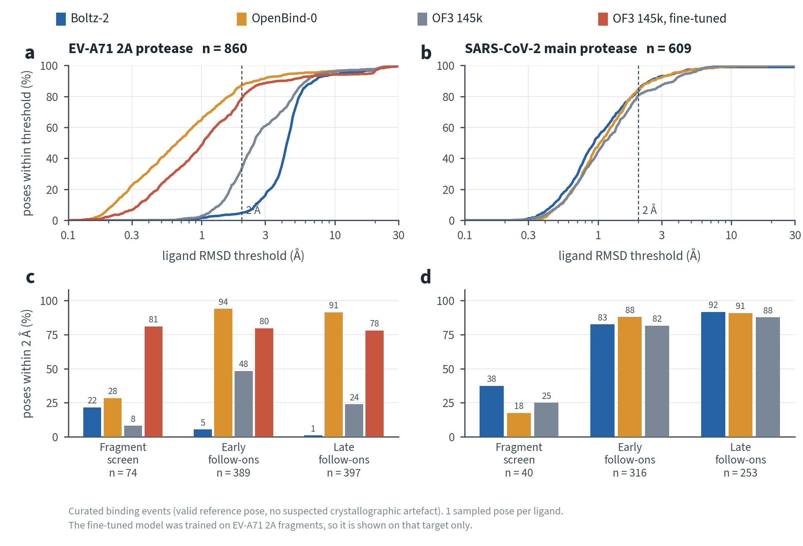

How to read the figure:

- **Panels a and b** show the share of poses within each error threshold. Curves that rise earlier are
  better. The dashed line marks the 2 Å cutoff.
- **Panels c and d** show the 2 Å success rate for each campaign stage.
- **Grey is OpenFold3 145k**, the general model Step 6 fine-tunes. Red is the same model after the
  OpenBind team fine-tuned it on EV-A71 2A fragments: the 2 lines are the before and after of 1 experiment.
- The fine-tuned model is shown on EV-A71 2A only, the target it was trained for. Its accuracy on a protease
  it never saw is a different question, in [Fine-tuning from a general model](#fine-tuning-from-a-general-model).

### Fine-tuning from a general model

A new project begins with a target that appears in no training set. The experiment below starts from the
general OpenFold3 145k model, fine-tunes it on the EV-A71 2A fragment screen with Ray Train, and scores it
on every follow-on compound, none of which appears in training.

| Late follow-ons, % within 2 Å | SARS-CoV-2 Mpro | MERS-CoV Mpro | EV-A71 2A |
|---|---|---|---|
| OpenFold3 145k, before | 87.7% | 73.5% | 23.9% |
| Fine-tuned with Ray Train, 66 fragments, 8 samples per step | 62.1% | 68.8% | **44.8%** |
| Fine-tuned with Ray Train, 80 fragments, 32 samples per step | 65.2% | 71.0% | 40.6% |
| Fine-tuned by the OpenBind team (released) | 56.5% | 66.4% | 78.1% |

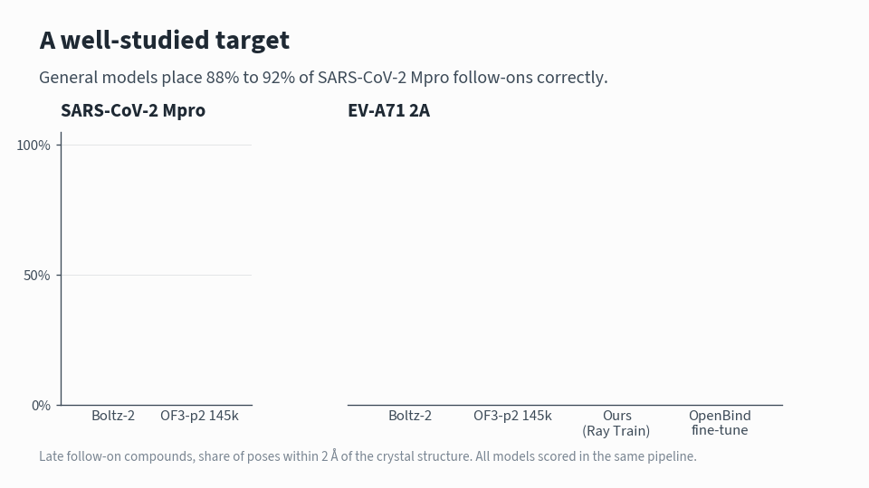

**Observations**

- 4 times the sampling per step did not help (40.6% against 44.8%), so the remaining distance to the released
  checkpoint is not training compute per step.
- Predicting 5 poses per compound instead of 1 lifts the general model from 23.9% to 32.7% on late follow-ons.
  The fine-tuned model does not gain from the same extra compute (44.8% with 1 pose, 43.8% with 5), so at 5
  poses each the comparison is 32.7% against 43.8%: fine-tuning beats extra inference compute here. Sampling
  is one reason published figures exceed ours, since the paper takes the top-ranked of 25 poses.
- Accuracy tracks chemical distance from the fragment screen, measured as the highest Morgan Tanimoto
  similarity to any fragment-screen compound. At 5 poses, the fine-tuned model reaches 41.4% on the 133 late
  follow-ons below 0.3, 43.5% on the 253 between 0.3 and 0.5, and 81.8% on the 11 at 0.5 or above, against
  30.8%, 33.6% and 36.4% for the general model. The gain is largest on compounds resembling the fragments
  and still present on the most distant ones.
- A fine-tuned model is a specialist. On the 2 proteases it was not trained for it gives up accuracy, from
  87.7% to 62.1% on SARS-CoV-2 and from 73.5% to 68.8% on MERS-CoV.
- All 4 fine-tuning variants were trained on **spot** GPUs in a single working session. Between them they
  lost 9 nodes to reclamation and finished every run, because a checkpoint every 100 steps caps the loss at
  about 13 minutes.

**From a standard OpenFold3 launch to Ray Train.** OpenFold3's own training stack (configuration, data module, losses,
per-sample gradient clipping, EMA, Lightning loop) runs unchanged inside each Ray Train worker. Only the launcher
changes:

| Usual launch | With Ray Train |
|---|---|
| `run_openfold train --runner_yaml finetune.yml` on 1 node | `TorchTrainer(train_loop_per_worker, scaling_config=ScalingConfig(num_workers=8, use_gpu=True))` |
| More nodes: a SLURM script, `torchrun` on every node, ranks and restarts handled by hand | Ray starts 1 worker per GPU, forms the process group and restarts failed workers |

**Why Ray Train on Anyscale, with evidence from these runs**

| | Evidence |
|---|---|
| **Multi-node with 1 flag** | 2 to 8 GPUs is `--num-workers 8`. A step takes 7.6 s on 2 GPUs and about 8 s on 8 separate nodes |
| **Observability** | Loss, protein-ligand lDDT, step time, GPU memory (13.2 GB of 24) and GPU utilization (about 81%) on every step |
| **Fault tolerance, so spot capacity works** | A spot node was reclaimed at step 700. Ray Train restarted the workers automatically; with a checkpoint every 100 steps the run resumes where it stopped |
| **Any GPU, any zone** | The same script ran on L4 and L40S, across availability zones, on spot and on-demand capacity |
| **Older software stacks** | 145k loads only in OpenFold3 0.4.3; Ray runs the workers in that environment with `runtime_env={"py_executable": ...}` |

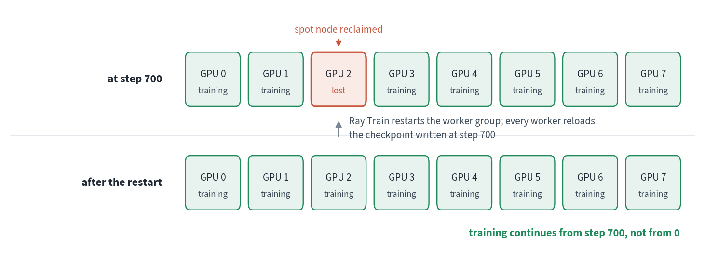

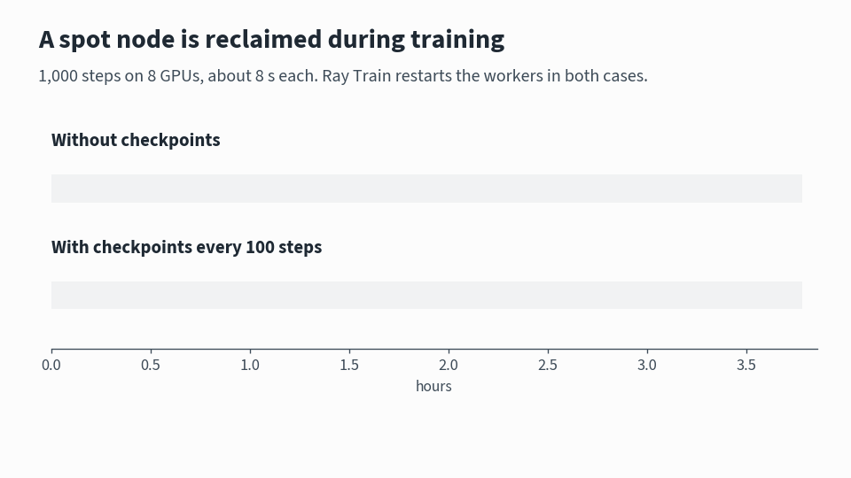

### Affinity

| Target | Ligands | Spearman ρ |
|---|---|---|
| EV-A71 2A (pKD) | 482 | 0.41 |
| SARS-CoV-2 Mpro (pIC50) | 164 | 0.86 |
| MERS-CoV Mpro (pIC50) | 142 | 0.59 |

On SARS-CoV-2 Mpro, the predictions form a weaker and a stronger cluster, and part of the high
correlation comes from separating the two. Within each cluster, ρ is 0.65 and 0.38.

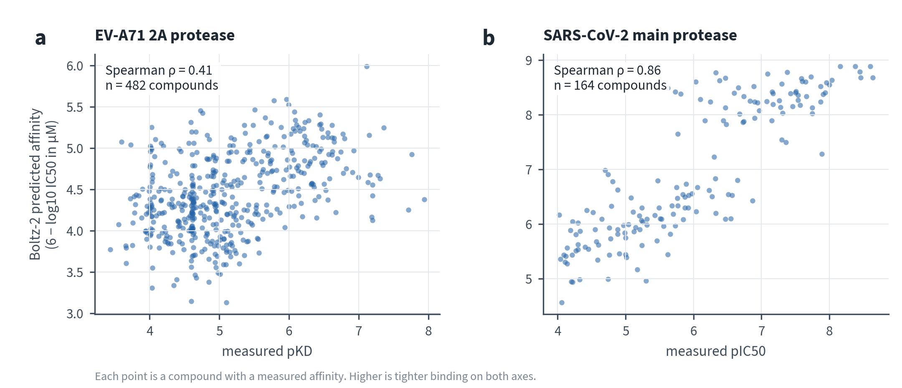

### Case study: 1 chemical series

The animation follows 1 EV-A71 2A series from a fragment to a potent follow-on, with each model's
prediction at every step.

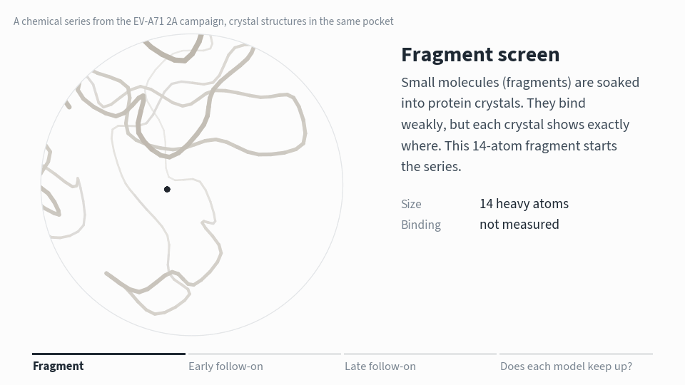

### Reproducibility

```bash
python scripts/compare_targets.py --csv summary.csv
```

The per-complex results are stored as Parquet:

```python
import pandas as pd
df = pd.read_parquet("/mnt/shared_storage/aiddd/results/ev71-2a")
df.groupby("stage")[["boltz2_lig_rmsd", "openbind0_lig_rmsd", "of3ft_lig_rmsd"]].median()
```

---

## Interactive viewer and live prediction

The results are also available as a web application built with Ray Serve. Chemists can browse every
crystal complex, compare each model's prediction with the experimental structure in 3D, and submit new
molecules for a live Boltz-2 prediction.


<sub>OpenBind-0's prediction for x7259a (green) overlaps the crystal pose (orange). The live prediction
on the left includes a plain-language reading of the result.</sub>

- **Leaderboard.** Every crystal complex, sorted by ligand RMSD, with a tab for each model.
- **3D comparison.** Selecting a row shows the predicted ligand (green) on the crystal ligand (orange).
- **Live prediction.** Paste a SMILES string to get a predicted pose, confidence and affinity from
  Boltz-2 on an L4 GPU, with an explanation of what the numbers mean. A new molecule takes 1 to 3
  minutes; repeated molecules return instantly from a cache.
- **Built-in guide.** A "How to read this page" panel explains RMSD, pKD, campaign stages and the live
  prediction metrics.
- **Scales with demand.** The Boltz-2 deployment adds GPU replicas as traffic grows, from 1 to 4.

See [Step 5](#step-5-viewer-and-live-prediction) to run it in a Workspace or share it as an Anyscale
Service.

---

## System design on Ray

Each model runs as its own Ray Data pipeline, and all pipelines share 1 autoscaling cluster. The scored
results feed the Ray Serve application described above.

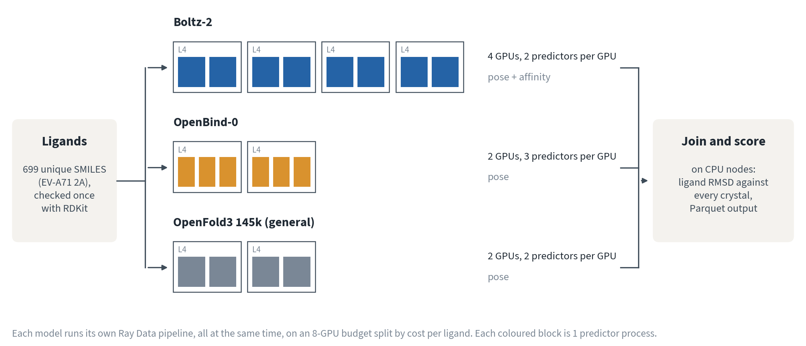

| Ray library | Role in this repository |
|---|---|
| Ray Data | Streaming pipeline: SMILES validation on CPU, model inference on GPU actors, pose scoring on CPU |
| Ray Train | Distributed fine-tuning of OpenFold3, using its own PyTorch Lightning training loop unchanged |
| Ray Tune [[15]](#ref-15) | Learning-rate search with ASHA early stopping [[14]](#ref-14), and a search over Boltz-2 inference settings |
| Ray Serve | Results viewer and live Boltz-2 prediction, with GPU replicas that scale independently |

### Design choices

- **Predict each ligand once.** On EV-A71 2A, the 925 binding events come from 699 unique ligands,
  because some crystals contain 2 copies. Predicting each ligand once and scoring it against every
  binding event saves about 25% of GPU time.
- **Batch inference.** Each GPU actor processes a batch of ligands in a single `boltz predict` or
  `run_openfold predict` call, so model weights load once per batch.
- **Share each GPU between predictors.** A single complex of 150 to 300 residues uses under 5 GB of GPU
  memory and leaves the GPU idle while inputs are prepared on the CPU. Fractional `num_gpus` requests
  place several predictors on 1 GPU, so 1 predictor computes while another prepares.
- **Run 1 pipeline per model.** Chaining all models in 1 pipeline makes every stage wait for the
  slowest. In 1 test, 4 Boltz-2 GPUs sat idle for over 10 minutes waiting for OpenFold3. Separate
  pipelines avoid this, and the driver joins the results before scoring.
- **Give each model a fixed GPU share.** `--max-gpus` sets the GPU budget, which is split across models
  by their measured cost per ligand. Each model gets a fixed actor pool
  (`ActorPoolStrategy(size=n, max_tasks_in_flight_per_actor=1)`), so the cluster scales straight to the
  budget and no batch waits behind a busy actor.
- **Score against the right protein copy.** Many crystals contain 2 protein chains. The predicted
  protein is superposed on the chain the ligand actually touches; using the wrong chain adds 30 to 40 Å of
  error. Ligand RMSD uses element-matched optimal assignment, which handles symmetric groups.
- **Cache every result.** Each ligand's structure (CIF) and metrics (JSON) are written to shared storage
  as soon as they finish, so interrupted jobs resume where they stopped.
- **Monitor GPU use.** The first predictor on each GPU node samples `nvidia-smi` every 5 seconds, and
  the job log reports the average utilization per node.

### Throughput with shared GPUs

1 L4 GPU, EV-A71 2A, 8 ligands per batch, from the sweep in `scripts/pack_sweep.py`:

| Predictors per L4 | 8 vCPU per node | 16 vCPU per node |
|---|---|---|
| OpenFold3, 1 | 23.8 s per ligand, 34% GPU | 23.1 s, 36% |
| OpenFold3, 2 | 20.2 s, 55% | **14.0 s, 75%** |
| OpenFold3, 3 | 20.7 s, 54% | 14.0 s, 75% |
| OpenFold3, 4 | 19.5 s, 55% | 14.1 s, 75% |
| Boltz-2, 1 | 39.2 s, 43% | 40.0 s, 43% |
| Boltz-2, 2 | 29.5 s, 69% | **28.0 s, 74%** |

- **2 predictors per GPU is the decisive setting.** A 3rd and 4th change nothing while costing GPU memory.
- **OpenFold3 gains only when the node has enough CPU**: 1.44 times faster on 16 vCPU than on 8, because it
  featurizes on the CPU while the GPU waits. Boltz-2 is not CPU-starved, so it gains about the same either way.
- With 64 GB per node and 2 predictors per GPU, OpenFold3 145k made 402 new predictions in 19 minutes on
  12 L4 GPUs at 80% GPU utilization.

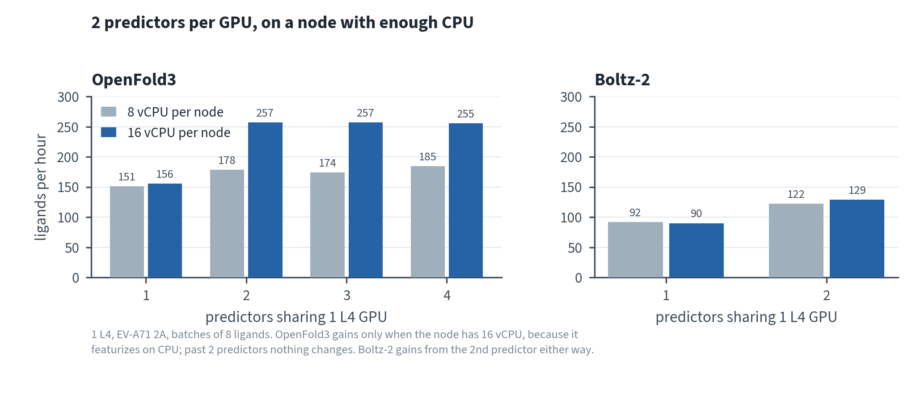

### GPU utilization by pipeline layout

MERS-CoV Mpro. The first 2 rows are earlier layouts on 8 L4 GPUs; the figure below is the default layout on 4:

| Pipeline layout | GPU utilization |
|---|---|
| 1 predictor per GPU, models chained | About 60% across the cluster |
| Shared GPUs, models chained | 0% on the 4 Boltz-2 nodes, 43 to 92% on the others |
| Shared GPUs, 1 pipeline per model (default) | 96% on average once all nodes were running |

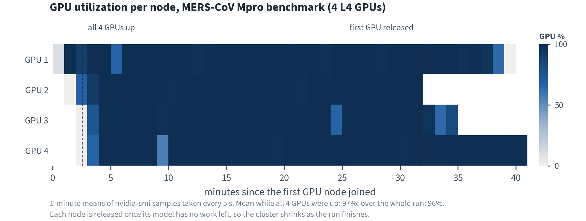

### Additional observations

- **Affinity samples.** On 160 EV-A71 2A ligands, 1 affinity sample ranks compounds as well as the
  default five (Spearman ρ of 0.37 and 0.36; the 2 agree at Pearson r = 0.99).
- **Hardware.** Both models fit on a 24 GB L4 GPU for these proteins (150 to 306 residues). For larger
  proteins, add an L40S worker group and pass `--of3-accelerator L40S`.

---

## Repository layout

```
.
├── 01_ray_and_offline_inference.ipynb  Ray Core, then offline batch inference with Ray Data
├── 02_train_and_tune.ipynb             Fine-tuning with Ray Train, sweeps with Ray Tune
├── 03_serve.ipynb                      The viewer and live prediction with Ray Serve
├── workshop_helpers.py                 Plotting, 3D viewer and data loading for the notebooks
│
├── aiddd_pipeline.py                   Ray Data benchmark pipeline: validate, predict, score
├── finetune_ray_train.py               Ray Train fine-tuning of OpenFold3 (TorchTrainer, Lightning DDP)
├── serve_viewer.py                     Ray Serve application: results viewer and live prediction
├── of3_live.py                         OpenFold3 held in memory, for Ray Serve model multiplexing
│
├── jobs/
│   ├── job.yaml                        Everyday Anyscale Job: benchmarks, fine-tuning, sweeps
│   ├── workshop.yaml                   The workshop's live run on pinned GPU nodes
│   ├── service.yaml                    Anyscale Service for sharing the viewer
│   └── demo_{1_base,2_ft,3_next_ft}.yaml  Live demo steps: add a model to the Service, in place
├── configs/
│   └── finetune_ev71.yml               OpenFold3 training settings used by the fine-tune
├── scripts/
│   ├── setup_data.py                   One-time download of data, published benchmark and weights
│   ├── prepare_mpro.py                 One-time build of the SARS-CoV-2 and MERS-CoV Mpro targets
│   ├── prepare_finetune.py             Builds the OpenFold3 training set from a fragment screen
│   ├── bench_checkpoints.py            Benchmarks every fine-tuned checkpoint on every target
│   ├── compare_targets.py              Summary table across targets, models and campaign stages
│   ├── pack_sweep.py                   Predictors per GPU and vCPUs per node: throughput sweep
│   ├── tune_finetune.py                Ray Tune learning-rate search over complete Ray Train runs
│   ├── tune_boltz.py                   Ray Tune search over Boltz-2 inference settings
│   └── check_serve.py                  End-to-end check of the Serve application and multiplexing
├── image/Containerfile                 Container image: Ray 2.59, Boltz-2, OpenFold3 0.5 and 0.4.3
└── docs/
    ├── images/                         Figures and animations used in this README and the notebooks
    └── figures/                        Scripts that redraw every figure from the benchmark results
```

---

## Getting started

With an Anyscale Workspace set up as in [Step 1](#step-1-workspace-and-image), 4 commands reproduce
the study:

```bash
python scripts/setup_data.py                            # 15 to 20 min, once
python aiddd_pipeline.py --limit 8 --max-gpus 2 \
  --out /mnt/shared_storage/aiddd/results/smoke           # 15 min, checks that everything works
anyscale job submit -f jobs/job.yaml --name aiddd-ev71 -- \
  python aiddd_pipeline.py --target ev71-2a --models boltz2,openbind0 --max-gpus 8 \
    --out /mnt/shared_storage/aiddd/results/ev71-2a       # 1 to 2 h, full benchmark
serve run serve_viewer:app                              # viewer and live prediction
```

To follow the workshop instead, open `01_ray_and_offline_inference.ipynb` in the Workspace and run the
cells in order, then `02_train_and_tune.ipynb` and `03_serve.ipynb`.

Both notebook settings live in the Setup cell of each notebook:

| Setting | Default | Meaning |
|---|---|---|
| `USE_GPUS` | `False` | `False` loads stored results for every GPU step. `True` runs them live and starts GPU nodes |
| `AIDDD_SERVICE_URL` | unset | Environment variable holding the address of the shared Anyscale Service (`aiddd-viewer`) for notebook 03. With `USE_GPUS = False`, section 6 sends its predictions there and 6.7 runs the room exercise; unset, those cells print how to set it and skip. With `USE_GPUS = True` (the presenter), section 6 runs its own Ray Serve pool in the Workspace |

### Workshop format

Complete Steps 2, 2b and 4 before the session. The 90-minute session then runs as follows:

| Minutes | Notebook | Activity |
|---|---|---|
| 0 to 10 | 01 | Workspace setup; submit the smoke test while nodes start |
| 10 to 25 | 01 | Smoke-test results and how to read the scoring output |
| 25 to 45 | 01 | Full benchmark: comparison by campaign stage and across targets |
| 45 to 60 | 01 | 3D viewer and pose overlays |
| 60 to 80 | 02 | Fine-tuning OpenFold3 145k with Ray Train: a short live run, then the full run trained beforehand |
| 80 to 90 | 03 | Ray Serve: the base model and its fine-tunes in one multiplexed pool, a new version added in place, and the whole room on one shared Service |

The Workspace has a limited number of GPUs, so run the cells of each notebook in order. In notebook 03,
attendees (`USE_GPUS = False`) use no Workspace GPU: their predictions go to the shared Service. Only the
presenter (`USE_GPUS = True`) starts a Ray Serve pool in the Workspace, which holds a GPU until the final
cell stops it.

**Getting `AIDDD_SERVICE_URL`.** The presenter shares the Service address at the start of the session:
`anyscale service status -n aiddd-viewer` prints it as `query_url` (today
`https://aiddd-viewer-5ms2e.cld-g54aiirwj1s8t9kt.s.anyscaleuserdata.com`). Set it as a Workspace
environment variable before starting the notebook, or paste it into the Setup cell in place of
`os.environ.get("AIDDD_SERVICE_URL", "")`. The same address opens the viewer page in a browser.

---

## Runbook

Times refer to the cluster defined in `jobs/job.yaml`.

| Step | Task | Time |
|---|---|---|
| 1 | Workspace and image | 5 min with a prebuilt image |
| 2 | Download data and weights | 15 to 20 min, once |
| 2b | Build the Mpro targets | About 10 min, once |
| 3 | Smoke test: 8 ligands, 3 models | 15 to 20 min, mostly node startup |
| 4 | Full benchmark: 1 target, 3 models | 1 to 2 h on 8 L4 GPUs |
| 5 | Viewer and live prediction | 5 to 10 min |
| 6 | Fine-tuning with Ray Train: 1,000 steps on 8 L4 GPUs | About 2.3 h |
| 7 | Searches with Ray Tune | 35 to 60 min |

### Step 1. Workspace and image

| Setting | Value |
|---|---|
| Container image | `anyscale/image/aiddd-boltz2-of3:4` |
| Head node | `m5.2xlarge`, CPU only, so the notebook never holds a GPU |
| Worker group | `g6.xlarge` or `g6.2xlarge` (1 L4 GPU), minimum 0, maximum 4 |

Clone this repository into the Workspace. To build the image yourself, run the command below, then set
`image_uri` in `jobs/job.yaml` and `jobs/service.yaml` to the version it prints:

```bash
anyscale image build -f image/Containerfile -n aiddd-boltz2-of3 -r 2.59.0
```

> **Python version.** Boltz-2 requires a SciPy release that does not build on Python 3.13. The image also
> contains a separate OpenFold3 0.4.3 install at `/opt/of3-legacy`, because the released fine-tuned
> checkpoint only loads with that version.

### Step 2. Download data and weights

```bash
anyscale job submit -f jobs/job.yaml --name aiddd-setup -- python scripts/setup_data.py
```

All data is stored under `/mnt/shared_storage/aiddd`, which every Workspace, Job and Service in the Anyscale cloud can read, whoever started it:

```
/mnt/shared_storage/aiddd/
  raw/OpenBind_EV-A71_2A/      structures, metadata CSV, FASTA, MSA        (500 MB)
  EV-A71_2A_benchmark/         published OpenBind results                  (11 MB)
  boltz_cache/                 Boltz-2 weights and chemical component data (6 GB)
  of3_cache/                   OpenBind-0, OF3-p2 and fine-tuned OF3 ckpts (11 GB)
```

- The script skips anything already downloaded and is safe to rerun.
- Pass `--skip-of3` to download Boltz-2 only.

### Step 2b. Build the Mpro targets

```bash
anyscale job submit -f jobs/job.yaml --name aiddd-mpro-setup -- python scripts/prepare_mpro.py
```

The script:

- downloads the ASAP Discovery and COVID Moonshot structures from Fragalysis,
- adds the ASAP potency data,
- builds 1 MSA per protein, and
- writes each target in the same layout as the OpenBind release.

### Step 3. Smoke test

Run 8 ligands (2 fragments and 6 follow-ons) through all 3 models:

```bash
anyscale job submit -f jobs/job.yaml --name aiddd-smoke -- \
  python aiddd_pipeline.py --models boltz2,openbind0,of3ft \
    --limit 8 --max-gpus 2 --out /mnt/shared_storage/aiddd/results/smoke
```

The job log ends with a summary like this:

```
Done in N min. 10 complexes scored -> /mnt/shared_storage/aiddd/results/smoke
  Boltz-2: {'ok': 8}
  OpenBind-0 (OF3): {'ok': 8}
  OF3 fine-tuned on EV-A71 2A: {'ok': 8}
```

- `ok` and `cached` both mean success. `cached` means an earlier run already predicted that ligand.
- For `failed` entries, the first error is printed below the summary.

### Step 4. Full benchmark

```bash
anyscale job submit -f jobs/job.yaml --name aiddd-ev71 -- \
  python aiddd_pipeline.py --target ev71-2a --models boltz2,openbind0,of3ft --max-gpus 8 \
    --out /mnt/shared_storage/aiddd/results/ev71-2a
anyscale job submit -f jobs/job.yaml --name aiddd-sars2 -- \
  python aiddd_pipeline.py --target sars2-mpro --models boltz2,openbind0,of3ft --max-gpus 8
anyscale job submit -f jobs/job.yaml --name aiddd-mers -- \
  python aiddd_pipeline.py --target mers-mpro --models boltz2,openbind0,of3ft --max-gpus 8
```

To score the general OpenFold3 145k model, use `jobs/job.yaml` and always give it its own results folder:

```bash
anyscale job submit -f jobs/job.yaml --name base-of3p2-ev71-2a -- \
  python aiddd_pipeline.py --target ev71-2a --models of3p2 --max-gpus 12 --of3-per-gpu 2 \
    --cpus-per-gpu-node 16 --out /mnt/shared_storage/aiddd/results_base-of3p2/ev71-2a
```

- Each job runs on its own cluster, so all 3 targets can run at the same time.
- **Always pass `--out` for anything other than the main benchmark.** The pipeline deletes its output folder when
  it starts, and the default is the folder the viewer reads.
- Predictions are cached per ligand, so a resubmitted job only predicts what is missing.
- While a job runs, the **Metrics** page of the Ray Dashboard shows GPU nodes joining and GPU use per
  node.

### Step 5. Viewer and live prediction

**In a Workspace, for development:**

```bash
python scripts/check_serve.py                                      # end-to-end check
AIDDD_RESULTS=/mnt/shared_storage/aiddd/results/ev71-2a serve run serve_viewer:app
```

Open the Workspace URL with `?port=8000` added. If your browser reports an invalid referer, paste the URL
into a new tab instead of clicking a link to it.

**As an Anyscale Service, to share with a room:**

```bash
anyscale service deploy -f jobs/service.yaml          # prints a public URL to share
anyscale service terminate -n aiddd-viewer       # after the session
```

- The Service runs on its own cluster, so it does not compete with the notebook for GPUs.
- Anyone with the URL can open the page and run GPU predictions, on up to 4 L4 GPUs.
- The Service does not shut down on its own. It keeps at least 1 L4 GPU running until you terminate
  it.

### Step 6. Fine-tuning with Ray Train

**Build the training set** (CPU, about 30 seconds, once):

```bash
python scripts/prepare_finetune.py --check                                   # 66 curated fragments
python scripts/prepare_finetune.py --paper-set \
  --out /mnt/shared_storage/aiddd/finetune/ev71-2a-frag80                      # the OpenBind paper's 80
```

- The default set keeps fragment complexes with a PoseBusters-valid reference, no suspected artefact and no
  covalent ligand, 1 binding event per compound (66).
- `--paper-set` keeps every binding event and PoseBusters-invalid references, as the OpenBind paper did (80).
- Both are fragments only, so every follow-on compound stays held out.

**Train from OpenFold3 145k** (8 L4 GPUs, about 2.3 hours):

```bash
anyscale job submit -f jobs/job.yaml --name ft-p2-evfrag -- \
  python finetune_ray_train.py --base p2 --num-workers 8 --max-steps 1000 --checkpoint-every 100
```

- `--base p2` starts from 145k. It loads only in OpenFold3 0.4.3, so the script re-runs itself in
  `/opt/of3-legacy` and starts the Ray Train workers there (`runtime_env={"py_executable": ...}`).
  `--base ob0` (the default) starts from OpenBind-0 in OpenFold3 0.5.
- `--checkpoint-every 100` reports a resume point every 100 steps. After a lost node, Ray Train restarts the
  workers and they continue from the latest checkpoint instead of step 0. Each checkpoint costs about 8 s.
- Run names describe the run: `ft-<base>-<data>-<steps>s-<gpus>g[-<n>samp][-<gpu>]-<MMDD-HHMM>`.

```
step  104  loss   0.232  avg10   0.149  distogram  1.392  lr 1.0e-04    6.9 s  13.2 GB
```

| Flag | Default | Description |
|---|---|---|
| `--base` | `ob0` | Starting weights: `ob0` (OpenBind-0) or `p2` (OpenFold3 145k) |
| `--num-workers` | 2 | Number of GPUs; 1 complex per GPU per step |
| `--max-steps` | 150 | Optimizer steps |
| `--lr` | 1e-4 | Peak learning rate, reached after `--warmup-steps` (10), then decayed to 10% |
| `--diffusion-samples` | 8 | Noise levels per complex per step (32 fits an L4: 13.4 GB) |
| `--data` | `finetune/ev71-2a` | Training set from `prepare_finetune.py` |
| `--checkpoint-every` | 100 | Steps between resume checkpoints (0: final weights only) |
| `--keep-checkpoints` | 1 | Checkpoints kept (0: all, to score accuracy against training steps) |
| `--fail-at-step` | off | Testing: crash once at this step to check that the run resumes |
| `--export-ema` | off | Export the EMA weights instead of the raw weights |

**Benchmark the new weights** on every target:

```bash
python scripts/bench_checkpoints.py --runs <run name> --targets ev71-2a,sars2-mpro,mers-mpro
```

This submits 1 job per target (`jobs/job.yaml`, 8 L4 GPUs each) with its own results folder
(`results_<run>/<target>`) and a fresh prediction folder, so poses from another checkpoint are never reused.
Runs named `ft-p2-*` are predicted with OpenFold3 0.4.3 (`--of3ray-legacy`).

### Step 7. Searches with Ray Tune

```bash
anyscale job submit -f jobs/job.yaml --name tune-ft    -- python scripts/tune_finetune.py   # about 35 min on 4 L4 GPUs
anyscale job submit -f jobs/job.yaml --name tune-boltz -- python scripts/tune_boltz.py      # about 60 min on 8 L4 GPUs
```

- **`scripts/tune_finetune.py`** runs each learning rate as a complete Ray Train trial. The ASHA scheduler stops
  weak trials early, and the best weights are tested on held-out early follow-on complexes.
- **`scripts/tune_boltz.py`** tests combinations of recycling steps, diffusion samples and physics-based steering
  for Boltz-2, with 1 L4 GPU per trial.

---

## Configuration reference

### `aiddd_pipeline.py`

| Flag | Default | Description |
|---|---|---|
| `--target` | `ev71-2a` | `ev71-2a`, `sars2-mpro` or `mers-mpro` |
| `--models` | `boltz2,openbind0` | Any of `boltz2`, `openbind0`, `of3p2`, `of3ft`, `of3ray` |
| `--limit` | all | First N ligands, a fixed mix of fragments and follow-ons |
| `--batch-size` | 8 | Ligands per GPU call; 8 to 16 works well |
| `--boltz-per-gpu` | 2 | Boltz-2 predictors sharing 1 GPU |
| `--of3-per-gpu` | 3 | OpenFold3 predictors sharing 1 GPU (models on OpenFold3 0.4.3 are capped at 2) |
| `--cpus-per-gpu-node` | 8 | vCPUs on each GPU node: 8 on g6.2xlarge, 16 on g6.4xlarge |
| `--gpu-split` | by cost | GPUs per model, for example `boltz2=14,openbind0=6` |
| `--stage` | all | Only 1 campaign stage, for example `"late follow-on"` |
| `--pred-dir` | shared cache | Write predictions to `<pred-dir>/<model>`, so a run recomputes every ligand |
| `--max-gpus` | 8 | GPUs for the whole pipeline, split across models by cost |
| `--accelerator` | `L4` | GPU type for Boltz-2, and for OpenFold3 unless overridden |
| `--of3-accelerator` | same as `--accelerator` | GPU type for the OpenFold3 stages |
| `--diffusion-samples` | 1 | Poses sampled per ligand |
| `--affinity-samples` | 5 | Boltz-2 affinity ensemble size, cached separately |
| `--affinity-only` | off | Only ligands with a measured affinity |
| `--of3ray-ckpt` | latest Ray Train run | Weights for the `of3ray` model |
| `--of3ray-legacy` | off | `of3ray` weights were fine-tuned from 145k: predict with OpenFold3 0.4.3 |
| `--out` | `$AIDDD_SHARED/results/<target>` | Output Parquet directory |

### Environment variables

| Variable | Default | Used by |
|---|---|---|
| `AIDDD_SHARED` | `/mnt/shared_storage/aiddd` | All scripts: data, weights, predictions and results |
| `AIDDD_RESULTS` | `$AIDDD_SHARED/results/ev71-2a` | `serve_viewer.py` |
| `AIDDD_OURS_RUN` | newest benchmarked `ft-p2-*` run | `workshop_helpers.py`: which fine-tune the notebook shows as "ours" |

---

## Troubleshooting

| Symptom | Cause and fix |
|---|---|
| `Missing /mnt/shared_storage/aiddd/...` | Data is not downloaded. Run Step 2 or Step 2b |
| Job stays at `pending=1` actors for several minutes | GPU nodes are starting. The first node usually takes 3 to 6 minutes |
| `InsufficientInstanceCapacity` | The cloud has no free GPUs of that type. `enable_cross_zone_scaling` tries other zones. If all fail, remove `--of3-accelerator L40S` so every stage uses L4 |
| Fine-tuning reports that the worker group timed out | Not enough free GPUs. Stop the Serve application from Section 7 (`serve shutdown`) and run the notebook in order |
| `Default checkpoint ... not found` from OpenFold3 | `of3_cache` is incomplete. Rerun `python scripts/setup_data.py` |
| `of3ft` fails with missing or unexpected state-dictionary keys | The job is not using the project image, so `/opt/of3-legacy` is missing. Check `image_uri` |
| CUDA out of memory in an OpenFold3 stage | Lower `--batch-size`, or add an L40S group and pass `--of3-accelerator L40S` |
| Viewer shows `not scored yet` | `AIDDD_RESULTS` points to a run that does not include that model |
| Live prediction never returns | No L4 GPU is available to the Workspace. Add an L4 worker group |
| Raylet killed repeatedly, nodes cycling, GPU use near 40% | Host memory exhausted by OpenFold3 0.4.3 predictors on 32 GB nodes. Use `jobs/job.yaml` (g6.4xlarge, 64 GB) and `--of3-per-gpu 2` |
| `Missing key(s) in state_dict: "model.version_tensor"` when training from 145k | 145k predates that buffer. `--base p2` already loads it non-strictly |
| `unexpected keyword argument 'fallback_conformer_source'` | A training set built with OpenFold3 0.5 read by 0.4.3. `--base p2` writes a compatible `training_cache_of3v04.json` |
| Learning rate stuck at 9.5e-5 after step 200 in a 145k run | OpenFold3 0.4.3 drops `decay_every_n_steps`. Fixed in `finetune_ray_train.py`; rerun runs started before 2026-10-23 01:00 |
| `Training was interrupted by node preemption` | A spot node was reclaimed. Ray Train restarts automatically; use `--checkpoint-every` so it resumes instead of starting over |
| `results/ev71-2a` is empty and the viewer shows nothing | A pipeline run without `--out` deleted it. Restore from a backup and always pass `--out` |
| `ModuleNotFoundError: scripts.prepare_finetune` under `/opt/of3-legacy` | The legacy install ships its own `scripts` package. Keep `scripts/__init__.py` in the repository |
| 3D view in the notebook shows only a static picture | The browser does not run scripts in notebook output. Run the cell again, or use the Serve viewer for an interactive view |

---

## Data sources and licenses

| Resource | Source | License |
|---|---|---|
| OpenBind EV-A71 2A structure and affinity release | [Zenodo 10.5281/zenodo.22142262](https://zenodo.org/records/22142262) | CC0 |
| OpenBind benchmark results | [OpenBind-Consortium/EV-A71_2A_benchmark](https://github.com/OpenBind-Consortium/EV-A71_2A_benchmark) | Apache 2.0 |
| Boltz-2 | [jwohlwend/boltz](https://github.com/jwohlwend/boltz) | MIT |
| OpenFold3 and OpenBind-0 weights | [aqlaboratory/openfold-3](https://github.com/aqlaboratory/openfold-3) | Apache 2.0 |
| Mpro crystal structures (ASAP Discovery, COVID Moonshot) | [Fragalysis, target CoV-Mpro](https://fragalysis.diamond.ac.uk/) | CC-BY 4.0 |
| Mpro potency (pIC50) | [ASAP x Polaris x OpenADMET challenge](https://huggingface.co/datasets/openadmet/ASAP_Polaris_OpenADMET_challenge) | MIT |
| MSAs for the Mpro targets | [ColabFold MSA server](https://colabfold.mmseqs.com) | |
| Ray diagrams in the notebook | [Ray documentation](https://docs.ray.io) | Apache 2.0 |

---

## References

1. <a id="ref-1"></a>OpenBind Consortium. OpenBind's first release: a structure–affinity dataset for structure-based AI.
   *bioRxiv* (2026). [doi:10.64898/2026.08.27.747600](https://doi.org/10.64898/2026.08.27.747600)
2. <a id="ref-2"></a>Passaro, S., Corso, G., Wohlwend, J., *et al.* Boltz-2: Towards accurate and efficient binding
   affinity prediction. *bioRxiv* (2025). [doi:10.1101/2025.06.14.659707](https://doi.org/10.1101/2025.06.14.659707)
3. <a id="ref-3"></a>The OpenFold3 Team. OpenFold3-preview (software, version 0.5.0). *Zenodo* (2026).
   [doi:10.5281/zenodo.17485509](https://doi.org/10.5281/zenodo.17485509)
4. <a id="ref-4"></a>Abramson, J., Adler, J., Dunger, J., *et al.* Accurate structure prediction of biomolecular
   interactions with AlphaFold 3. *Nature* **630**, 493–500 (2024).
   [doi:10.1038/s41586-024-07487-w](https://doi.org/10.1038/s41586-024-07487-w)
5. <a id="ref-5"></a>Weininger, D. SMILES, a chemical language and information system. 1. Introduction to methodology
   and encoding rules. *J. Chem. Inf. Comput. Sci.* **28**, 31–36 (1988).
   [doi:10.1021/ci00057a005](https://doi.org/10.1021/ci00057a005)
6. <a id="ref-6"></a>Berman, H. M., Westbrook, J., Feng, Z., *et al.* The Protein Data Bank. *Nucleic Acids Res.*
   **28**, 235–242 (2000). [doi:10.1093/nar/28.1.235](https://doi.org/10.1093/nar/28.1.235)
7. <a id="ref-7"></a>Škrinjar, P., Eberhardt, J., Durairaj, J., Schwede, T. Have protein-ligand co-folding methods
   moved beyond memorisation? *bioRxiv* (2025).
   [doi:10.1101/2025.02.03.636309](https://doi.org/10.1101/2025.02.03.636309)
8. <a id="ref-8"></a>Mirdita, M., Schütze, K., Moriwaki, Y., *et al.* ColabFold: making protein folding accessible to
   all. *Nat. Methods* **19**, 679–682 (2022). [doi:10.1038/s41592-022-01488-1](https://doi.org/10.1038/s41592-022-01488-1)
9. <a id="ref-9"></a>Buttenschoen, M., Morris, G. M., Deane, C. M. PoseBusters: AI-based docking methods fail to
   generate physically valid poses or generalise to novel sequences. *Chem. Sci.* **15**, 3130–3139 (2024).
   [doi:10.1039/D3SC04185A](https://doi.org/10.1039/D3SC04185A)
10. <a id="ref-10"></a>Rogers, D., Hahn, M. Extended-connectivity fingerprints. *J. Chem. Inf. Model.* **50**, 742–754
    (2010). [doi:10.1021/ci100001p](https://doi.org/10.1021/ci100001p)
11. <a id="ref-11"></a>Mariani, V., Biasini, M., Barbato, A., Schwede, T. lDDT: a local superposition-free score for
    comparing protein structures and models using distance difference tests. *Bioinformatics* **29**, 2722–2728
    (2013). [doi:10.1093/bioinformatics/btt473](https://doi.org/10.1093/bioinformatics/btt473)
12. <a id="ref-12"></a>Boby, M. L., Fearon, D., Ferla, M., *et al.* Open science discovery of potent noncovalent
    SARS-CoV-2 main protease inhibitors. *Science* **382**, eabo7201 (2023).
    [doi:10.1126/science.abo7201](https://doi.org/10.1126/science.abo7201)
13. <a id="ref-13"></a>Moritz, P., Nishihara, R., Wang, S., *et al.* Ray: a distributed framework for emerging AI
    applications. In *Proc. 13th USENIX Symposium on Operating Systems Design and Implementation (OSDI)*,
    561–577 (2018). [arXiv:1712.05889](https://arxiv.org/abs/1712.05889)
14. <a id="ref-14"></a>Li, L., Jamieson, K., Rostamizadeh, A., *et al.* A system for massively parallel
    hyperparameter tuning. In *Proc. Machine Learning and Systems (MLSys)* **2** (2020).
    [arXiv:1810.05934](https://arxiv.org/abs/1810.05934)
15. <a id="ref-15"></a>Liaw, R., Liang, E., Nishihara, R., *et al.* Tune: a research platform for distributed model
    selection and training. *arXiv* (2018). [arXiv:1807.05118](https://arxiv.org/abs/1807.05118)
